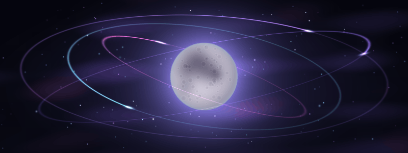

 

# WELCOME TO MY GITHUB PORTFOLIO

### STUDENT · ASPIRING DEVELOPER

 

  

  

---

## About Me

<table>
<tr>
<td width="60%" valign="middle">

Hi, I'm **Akash S** — a student passionate about programming, technology and software development.

I enjoy building practical projects, exploring new technologies and improving my skills through hands-on experience.

### My Interests

- Exploring software development
- Learning Python and application development
- Exploring web development
- Creating modern user interfaces
- Building real-world projects
- Improving my skills through experimentation

### My Approach

**Build it. Learn from it. Improve it.**

</td>
<td width="40%" align="center" valign="middle">

**AKASH S**

STUDENT / ASPIRING DEVELOPER

</td>
</tr>
</table>

---

## Technology Arsenal

### Programming Languages

### Frameworks & Libraries

### Developer Tools

---

## GitHub Overview

---

## Contribution Calendar

  

  

CONSISTENCY IS BUILT ONE CONTRIBUTION AT A TIME

---

## Featured Projects

PROJECTS, EXPERIMENTS AND IDEAS

<table>
<tr>
<td width="50%" valign="top">

### EMI Calculator Pro

Financial calculator application.

</td>
<td width="50%" valign="top">

### Neon Tic Tac Toe

Interactive neon-themed game.

</td>
</tr>

<tr>
<td width="50%" valign="top">

### Python QR Code Generator

QR code generation application.

</td>
<td width="50%" valign="top">

### WeatherNow

Weather information application.

</td>
</tr>

<tr>
<td width="50%" valign="top">

### RPS Arena

Rock Paper Scissors game.

</td>
<td width="50%" valign="top">

### More Projects

Explore my other repositories and experiments.

</td>
</tr>
</table>

---

## Connect With Me

Let's connect and share ideas!

  

---

<!-- FINAL SIGNATURE -->

  

  

### BUILDING · LEARNING · EVOLVING

THANK YOU FOR VISITING

